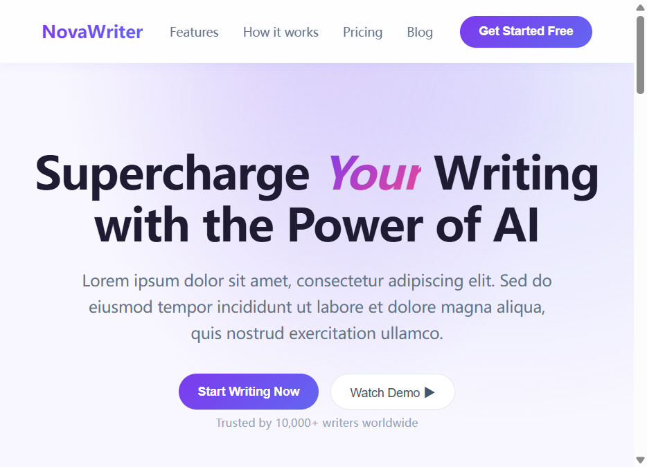

# BetterFront-SKILL

> **AI writes frontend. BetterFront makes it memorable.**
> Give your coding agent the animated-frontend brain — so Claude Code / Trae / Cursor ship UI that feels designed, not generated.

[](LICENSE)


**Unofficial community skill** — built on the open [Agent Skills](https://agentskills.io) spec. Makes your AI coding agent work like a senior engineer who knows every one of the 217 animated components in React Bits.

> **v1.7.0 — rebuilt decision layer.** Selection moved from "list components by category" to a three-stage **site type → visual constraint → component** pipeline. All 217 components now enter the candidate pool (in v1.6 only 54/217 = 25% had any recommendation path). One command runs all consistency checks:
> ```bash
> node scripts/select.mjs --site-type saas --background-mode dark --mobile-ratio high
> node scripts/verify.mjs   # 39 checks, exit 0
> ```

**中文文档**：[README.md](README.md)

---

## Why you need it

Three failure modes when AI writes animated React pages:

| Pain | BetterFront's answer |
|---|---|
| Hallucinated component names, wrong variant suffixes, missing deps | **217-component catalog snapshot** (auto-synced from the official data source); the dependency column is **217/217 filled** (synced from the official registry, `-` when none); 19 ⚡WebGL flags derived by rule, not by hand; JS/TS × CSS/Tailwind variant auto-detection |
| Only 54 of 217 components had any recommendation path — selection was guesswork | **Unified attribute pool + three-stage selector**: `components.yaml` (217 rows × 9 fields) × `select.mjs` (site type → constraints → intensity ranking); reproducible top-3 for all 25 site types × 4 constraint combos |
| Each doc invented its own industry names, vocabularies never matched | **One vocabulary in `taxonomy.json`**: 25 site types / 10 regions / constraint enums; every legacy theme name in the three references is 100% mapped into it |
| Guesswork selection — the user never gets a say | **Mandatory interaction checkpoints**: the AI only proposes "theme analysis → 2–4 candidates → local preview"; you decide |
| Descriptions but no usage guidance | **`component-usage.md`**: import paths, required props, deps and real-world gotchas for the 31 most-used components |
| Cursor-driven motion silently dies on touch devices | **Touch degradation list**: the 46 cursor-driven backgrounds called out explicitly ("no effect on touch / needs static first-frame fallback"), in both theme-backgrounds and pitfalls |
| The generic "AI slop" look | **9-item anti-template blacklist + 14-item layout checklist** (inspired by top-rated GitHub design skills), plus a mandatory design contract before coding |

## Before / After — same prompt, with and without the skill

> Prompt: *"Build a SaaS landing page for NovaWriter, an AI writing assistant"*
> Both pages are real, openable static files — see [demo/comparison/](demo/comparison/).

| Without the skill (before) | With the skill (after) |
|---|---|
|  |  |

**What exactly changed** (mapped to specific skill rules):

| The "AI tell" in before | What after does instead | Which skill rule |
|---|---|---|
| Purple gradients + gradient-italic single-word headline | Dark canvas + one brand cyan, only the key word "定稿" accented | layout-guide · blacklist #1/#7 |
| Lorem ipsum filler | Realistic Chinese product copy (copy that exposes layout problems is good copy) | layout-guide · blacklist #8 |
| Everything is a card: same radius, same shadow, same 3-col grid | Cards only for real grouping, asymmetric 3:2 grid, zero shadows | layout-guide · blacklist #4 + spacing rules |
| ALL-CAPS eyebrow over every heading + meaningless big 01/02/03 | Semantic meta info; inline step numbers only because it truly is a sequence | layout-guide · blacklist #2/#3 |
| `10k+ · 1M+ · 99%` middot strings | 4 stats, each with a verifiable concrete metric | layout-guide · blacklist #5 |
| Motion: unfocused or over-decorated | Exactly one focal animation = decrypting headline, with the nebula aurora as ambience | layout-guide · blacklist #6 + "spend boldness in one place" |
| Buttons are static gradient blocks | A starlight trail orbits the button outline (Star Border equivalent) | interactions · button emphasis |
| Content appears with no rhythm | Section-level scroll reveals, block-level not per-card (Animated Content equivalent) | interactions · transitions |
| Cards give zero interactive feedback | A spotlight glow follows the pointer (Spotlight Card equivalent) | interactions · components |
| Stats are hard-coded static numbers | Numbers count up on viewport entry (Count Up equivalent) | interactions · micro-interactions |

Open [demo/comparison/before.html](demo/comparison/before.html) and [demo/comparison/after.html](demo/comparison/after.html) in your browser to compare live (the after page has a decrypting headline, star-border button, parallax aurora and card spotlights — the parts a screenshot can't capture).

## Capabilities

| Capability | What it does |
|---|---|
| 🧭 Three-stage selection | Site type (25) → visual constraints (dark/light, mobile share, text overlay) → intensity ranking; returns a top-3 with match reasons |
| 🎨 Background theme matching | Three-step theme analysis (domain + mood + constraints) → candidate backgrounds with concrete color parameters |
| 🖱️ Interaction selection | Buttons / transitions / micro-interactions bundled at three intensity tiers (subtle / accent / immersive) |
| 📐 Layout discipline | Design contract → skeleton recipes as **ranges + trigger conditions** (e.g. portfolio header 40–70vh) → 8pt spacing → 1.25 type scale → 60-30-10 color |
| 📖 Component usage notes | Import paths, required props, deps and tested gotchas for the 31 most-used components |
| ✅ Dual-resolution verification | 1920×1080 + 1366×768 screenshot self-check for both motion and layout |
| 🔄 Auto-syncing catalog | One command refreshes the component catalog and deps, and flags any stale component references |
| 🔍 One-command consistency check | `node scripts/verify.mjs` runs all 39 checks across 7 groups (data layer / vocabulary / attribute pool / selector / skeletons / touch list) — green means shippable |

## Install

```bash
# Claude Code (global)
git clone https://github.com/Qz-zhong/BetterFront-SKILL ~/.claude/skills/betterfront

# Trae (project-level)
git clone https://github.com/Qz-zhong/BetterFront-SKILL .trae/skills/betterfront

# Any other spec-compliant agent
drop this repo into your agent's skills directory
```

Then just tell your agent: *"build me a landing page for X"* — the skill steps in automatically.

**Agent-agnostic by design** (no dependency on any single toolchain):

**Zero-dependency core**: all decision knowledge is plain static files — `catalog.md` (217 components), `taxonomy.json` (shared vocabulary), `components.yaml` (217×9 attribute pool), the layout rules and the anti-template blacklist.
Any agent that can read a file can run the full 5-step workflow — **no Node, no MCP, no network, no vendor-specific API**. That is exactly why it works across agents.

The four items below are **accelerators** (they turn minutes of manual work into one command). The order is always
**run the best path first, fall back only when it actually fails** — do not probe the environment up front: Node may exist but be older than 18,
npx may exist while offline, a browser tool may exist without chromium installed. **A real error is a certain signal; a prediction is not.**
The only exception is project config (`package.json` / `components.json` / `tsconfig.json`) — that is information gathering and must be read actively.

| Accelerator | ① Preferred | ② Failure signal → ③ Fallback |
|---|---|---|
| Selection: Node (≥18) running `scripts/select.mjs` | `node scripts/select.mjs --site-type <id> ...` | `node: not found` / version <18 → read `taxonomy.json` to fix site_type, filter matching rows in `components.yaml`, sort by `visual_intensity` desc and drop `avoid_when` hits |
| Install: MCP / registry channel | Channel A: install via MCP | MCP tool missing / registry not configured → Channel B: `npx shadcn@latest add ...`; if that fails too → Channel C, copy source manually |
| Verify: browser automation | Start dev server → 1920×1080 + 1366×768 screenshots | No browser tool / missing chromium → give `npm run dev` instructions + an expected-effects checklist and ask the user to eyeball it |
| Sync: network | `node scripts/sync-catalog.mjs` | fetch failed / timeout → keep going with the vendored 217 catalog + `deps.json`; the workflow does not stop |

Fallback means **a different path**, not a lost feature. Measured fallback fidelity: for the space/aerospace theme the script and a hand-run
`grep -w space` produce **the same pool of 11 candidates**, with `WarpText` first in both. The only difference is ordering inside the top 3 —
the script scores on multiple axes (visual intensity + theme specificity ×1.6 + region priority + constraint penalties), while the manual path only approximates it.

⚠️ This table describes the **host runtime environment** (is Node installed, is MCP configured, can it screenshot, is there network) —
a dimension that is **orthogonal** to "which agent you use". Nothing here is a capability only one particular agent has,
so taking a fallback path is not a lost feature and does not weaken cross-agent portability.

## Compatibility

| Agent | Status |
|---|---|
| Claude Code | ✅ verified |
| Trae | ✅ verified |
| Cursor / Codex / Windsurf and other spec-compliant agents | 🟡 community verification welcome |
| Vue / mini-programs / non-React | ❌ not applicable |

## Credits

Standing on the shoulders of these excellent open-source projects:

- [React Bits](https://github.com/DavidHDev/react-bits) — the component source; catalog data syncs from its official `llms.txt`
- [anthropics/skills](https://github.com/anthropics/skills) — the anti-template blacklist and design-contract ideas from `frontend-design`
- [addyosmani/agent-skills](https://github.com/addyosmani/agent-skills) — spacing-scale and visual-hierarchy rules
- [impeccable-lite](https://github.com/ilindaniel/impeccable-lite) — layout details and whitespace rhythm
- [shadcn-ui](https://github.com/shadcn-ui/ui) — the component install CLI channel
- [Trae](https://www.trae.ai) · [Claude Code](https://claude.com/claude-code) — the Agent Skills ecosystem

> **Disclaimer**: BetterFront is an unofficial community project, not affiliated with React Bits or its commercial Pro edition. The catalog only references publicly available component names and descriptions — no component source code is included or resold.

## License

[MIT](LICENSE)
